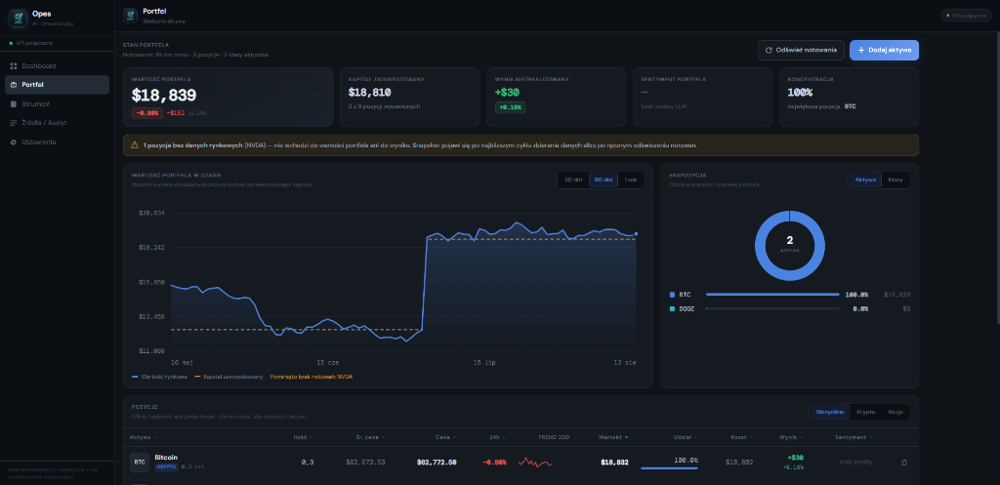

# Opes — Inteligentny agregator informacji rynkowej pod portfel

> Osobisty system, który dla aktywów **faktycznie znajdujących się w twoim portfelu** zbiera
> informacje z wielu źródeł (GDELT, RSS, opcjonalnie Gemini, dane rynkowe krypto/akcji/ETF),
> **filtruje to, co naprawdę dotyczy twoich pozycji**, liczy sentyment i streszcza je przez LLM.
> System **informacyjny i diagnostyczny** —
> **nie rekomenduje transakcji** i nie składa zleceń.

Projekt realizowany jako praca inżynierska.

**Teza pracy:** *„Osobisty system do filtrowania i streszczania informacji rynkowej pod skład
portfela inwestycyjnego, z LLM jako modułem analitycznym."*



---

## Idea

Inwestor tonie w informacjach: setki newsów i tysiące postów dziennie, z których **większość nie
dotyczy tego, co faktycznie ma w portfelu**. Ten projekt sprawdza, czy LLM w roli modułu
analitycznego potrafi ten szum odfiltrować i zsyntetyzować.

- Maszyna **zbiera** dane z wielu źródeł (GDELT, RSS, opcjonalnie Gemini, ceny, funding) i
  **dopasowuje** je do aktywów z portfela operatora.
- **Filtr trafności** odrzuca to, co nie dotyczy posiadanych pozycji — to rdzeń silnika.
- Moduł LLM (Claude lub OpenAI, wybór po porównaniu jakości i kosztów API) **streszcza** trafne
  informacje, liczy sentyment i **wyjaśnia w kontekście** zauważalne ruchy cen.
- Operator dostaje **spersonalizowany feed** — bez rekomendacji „kup/sprzedaj".

Punkt ciężkości to **jakość filtrowania i syntezy informacji**, a nie predykcja ceny ani zysk:
trafność dopasowania newsów do aktywów, jakość i ugruntowanie streszczeń, latencja wypłynięcia
istotnego wydarzenia.

---

## Jak to działa

```
Skład portfela ─────────────┐
                            ├──► Filtr trafności ──► Sentyment + streszczenie LLM ──► Spersonalizowany feed
Źródła newsowe (GDELT/RSS) ─┘         (rdzeń)                                              (+ powiadomienia)
Ceny: Bybit + adaptery akcji/ETF ───► Wyjaśnianie ruchów cen (kontekst LLM) ─────────────┘
```

1. **Portfel** — w wersji podstawowej operator wpisuje skład portfela ręcznie. Integracja
   read-only z brokerem lub giełdą jest etapem po pierwszych testach aplikacji.
2. **Zbieranie** — GDELT, wybrane kanały RSS, opcjonalnie Gemini Search Grounding, dane
   krypto/funding z Bybit API v5 oraz dane akcji/ETF przez adaptery dostawców.
3. **Filtr trafności** — dopasowanie pozyskanych itemów do posiadanych aktywów (matching encji /
   tickerów + trafność embeddingowa). Items poniżej progu są odrzucane.
4. **Analiza LLM** — moduł LLM streszcza trafne informacje per aktywo, liczy sentyment i — gdy cena
   znacząco się rusza — wyjaśnia ją w kontekście wykrytych wydarzeń. Bazowo porównywane są Claude
   i OpenAI pod kątem jakości oraz kosztów API.
5. **Feed** — operator widzi spersonalizowany przegląd w dashboardzie (PWA) i powiadomienia.
6. **Wszystko jest logowane** do Supabase PostgreSQL — źródło, prompt, odpowiedź LLM, ocena
   trafności.

---

## Czego system NIE robi (świadomie)

| Nie robi | Dlaczego |
|----------|----------|
| Nie rekomenduje `BUY/SELL/HOLD` | System jest informacyjny — unika charakteru porady inwestycyjnej |
| Nie składa zleceń na giełdzie | Brak warstwy egzekucji; klucze API tylko-odczyt |
| Nie przewiduje ceny | Mierzymy jakość syntezy informacji, nie trafność predykcji |

---

## Stack technologiczny

**Backend:** Python 3.12 (asyncio) · FastAPI · Supabase (PostgreSQL + Auth) · Bybit API v5/pybit ·
adaptery Alpha Vantage/Finnhub/Polygon dla akcji i ETF-ów · anthropic SDK / OpenAI SDK za wspólnym
interfejsem LLM · google-generativeai (opcjonalne Gemini Search Grounding) · sentence-transformers ·
pandas-ta · Redis · tenacity
**Frontend:** React/Next.js 14 (PWA — service worker, instalowalność, powiadomienia push) ·
TailwindCSS · Recharts · use-websocket · Supabase Auth
**Infra:** Docker Compose · Supabase (managed lub local stack) · Redis 7

## Struktura katalogow

```text
backend/
  src/
  tests/
  pyproject.toml
frontend/
```

### Źródła danych

- **Kryptowaluty:** Bybit API v5, w trybie tylko-odczyt.
- **Akcje i ETF-y:** adaptery dostawców Alpha Vantage, Finnhub lub Polygon, wybierane zależnie od
  limitów darmowych planów.
- **Newsy:** GDELT, wybrane kanały RSS oraz opcjonalnie Gemini Search Grounding.

---

## Uruchomienie

### Szybki start (wszystkie usługi naraz):

```bash
# Git Bash / Linux / macOS:
./start.sh

# Windows Command Prompt:
start.bat

# Windows PowerShell:
.\start.ps1
```

### Ręczne uruchamianie komponentów krok po kroku:

```bash
# 1. Zmienne środowiskowe
cd backend
cp .env.example .env            # uzupełnij SUPABASE_*, LLM_PROVIDER, klucze API i RSS_FEEDS

# 2. Supabase + cache
supabase start                   # albo skonfiguruj projekt Supabase w chmurze
docker-compose up -d redis

# 3. Zależności
pip install -e ".[dev]"

# 4. Migracje / schemat Supabase
supabase db push

# 5. API / feed
uvicorn src.dashboard.api:app --reload --port 8000

# 6. Frontend PWA (osobny terminal)
cd ../frontend && npm install && npm run dev
```

> **Bezpieczeństwo:** ewentualne klucze Bybit/brokera wyłącznie z uprawnieniami *read* — system nie
> handluje, więc nie potrzebuje *trade* ani *withdraw*. W MVP skład portfela jest wpisywany ręcznie.

### Automatyczny deploy (serwer)

Każdy merge do `main` uruchamia workflow [`.github/workflows/deploy.yml`](.github/workflows/deploy.yml),
który łączy się z serwerem przez SSH i wykonuje [`deploy.sh`](deploy.sh): `git reset` do
`origin/main`, `docker compose up -d --build --wait` i sprzątanie starych obrazów. Deploy można
też odpalić ręcznie (Actions → Deploy → Run workflow) albo na serwerze: `./deploy.sh`.

Jednorazowa konfiguracja:

1. Na serwerze repo sklonowane do katalogu docelowego, z uzupełnionymi `.env` i `backend/.env`
   (przy prywatnym repo serwer potrzebuje deploy key z dostępem do odczytu).
2. Osobna para kluczy dla GitHub Actions: `ssh-keygen -t ed25519 -f opes_deploy -N ""`,
   klucz publiczny dopisany do `~/.ssh/authorized_keys` na serwerze.
3. W GitHub → Settings → Environments utwórz środowisko `production` z sekretami:

| Sekret | Wartość |
|--------|---------|
| `SSH_HOST` | adres serwera (np. `srv12.mikr.us`) |
| `SSH_PORT` | port SSH (na mikr.us niestandardowy, np. `10123`) |
| `SSH_USER` | użytkownik na serwerze |
| `SSH_PRIVATE_KEY` | zawartość pliku `opes_deploy` (klucz prywatny) |
| `SSH_KNOWN_HOSTS` | wynik `ssh-keyscan -p <port> <host>` |
| `DEPLOY_PATH` | ścieżka do repo na serwerze, np. `/home/user/Praca-Inz` |

---

## Testy

```bash
cd backend
python -m pytest tests/ -v --tb=short
```

Testy jednostkowe pokrywają collector, wskaźniki, filtr trafności, analizę LLM, repozytoria i
pętlę główną. Testy integracyjne wymagają działającego Supabase/PostgreSQL i Redisa.

---

## Status i roadmap

**Zaimplementowane (rdzeń odziedziczony):** zbieranie danych multi-TF dla krypto, wskaźniki,
funding, web research (Gemini), wywołania Claude z retry (do opakowania w modułowy LLM provider),
warstwa persystencji (do migracji na Supabase), REST + WebSocket API, szkielet frontendu.

**W planie (silnik informacyjny):**
- ręczny model portfela jako MVP i lista śledzonych aktywów,
- integracja read-only z brokerem lub giełdą dopiero po pierwszych testach aplikacji,
- adaptery danych rynkowych: Bybit API v5 dla krypto oraz Alpha Vantage/Finnhub/Polygon dla
  akcji i ETF-ów,
- integracja źródeł newsowych: GDELT, RSS i opcjonalnie Gemini Search Grounding,
- migracja warstwy danych i autoryzacji do Supabase,
- **filtr trafności** item↔aktywo (matching encji + embeddingi),
- modułowy LLM provider: Claude lub OpenAI po porównaniu jakości i kosztów API,
- streszczanie i sentyment per aktywo + wyjaśnianie ruchów cen,
- spersonalizowany feed we frontendzie + powiadomienia (PWA),
- harness ewaluacyjny: precision/recall trafności, jakość/ugruntowanie streszczeń.

**Wsparcie (opcjonalnie):** lekka diagnostyka portfela (korelacje, ekspozycja) jako funkcja
uzupełniająca.

Szczegółowy stan: [`docs/STATUS_AND_ROADMAP.md`](docs/STATUS_AND_ROADMAP.md).

---

## Uwaga

Projekt ma charakter badawczo-edukacyjny (praca inżynierska). Jest systemem **informacyjnym** —
nie stanowi porady inwestycyjnej ani rekomendacji. Klucze giełdowe używane są wyłącznie w trybie
tylko-odczyt.
